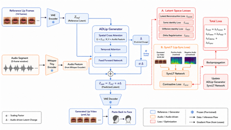
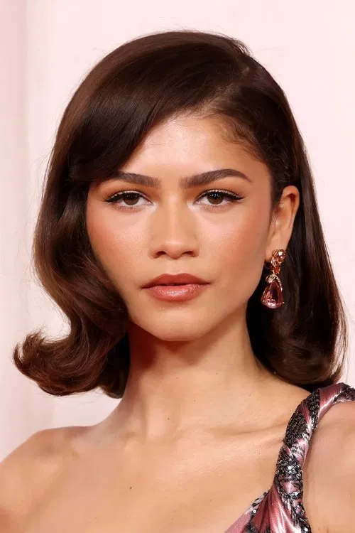

# Audio-Driven Talking-Head Generation

**Data Science Capstone Design · 2026**

A MuseTalk-based talking-head generation project exploring speech-conditioned lip refinement and audio-visual synchronization.

[Architecture](docs/architecture.md) · [Experiments](docs/experiments.md) · [Web Demo](docs/demo.md)

## Project Overview

- **Baseline:** MuseTalk v1.0 end-to-end inference and Gradio preview
- **Proposed extension:** ADLip Generator + SyncLT, operating on a **96×96 lip ROI**
- **Public implementation:** MuseTalk training, preprocessing, normal/realtime inference, SyncNet utilities, and Gradio demo
- **Availability:** The ADLip/SyncLT design is documented, but its source code and trained weights are not included in this repository.

## Approach

### Lip-Centric Architecture



The documented extension uses a frozen VAE to encode reference lip frames and Whisper Tiny to extract audio features. The ADLip Generator combines spatial cross-attention, temporal attention, and feed-forward refinement to predict a residual latent change:

`Z_out = Z_ref + αΔ`

The proposed training objectives include latent reconstruction, same/different identity losses, delta regularization, and SyncLT contrastive loss for matched and mismatched audio-video pairs. Further detail is in [architecture.md](docs/architecture.md).

### MuseTalk Inference Pipeline

Reference media undergoes face detection, DWPose processing, cropping, and VAE encoding. Whisper audio features condition the MuseTalk UNet; decoded frames are blended with the reference face and combined with audio through FFmpeg.

The public scripts support MuseTalk v1.0/v1.5 layouts and normal/realtime inference modes.

## Results

### ADLip Generator + SyncLT — Generation Sample

The project contributor identified the following **portrait + speech audio → talking-head video** sample as an ADLip/SyncLT output.

| Input portrait | Generated video |
| :---: | :---: |
|  | [Watch output](results/result.mp4) |

[Input audio](results/audio.mp4) · [Generated video](results/result.mp4)

### MuseTalk Baseline

End-to-end v1.0 inference and Gradio output preview were validated. One baseline sample took approximately **seven hours**; this is not a throughput benchmark.

## Repository Structure

| Path | Purpose |
| --- | --- |
| `app.py` | Gradio interface |
| `train.py`, `train.sh` | Training entry points |
| `inference.sh`, `scripts/` | Inference and preprocessing |
| `configs/` | Model and runtime settings |
| `musetalk/` | Models and supporting utilities |
| `download_weights.sh`, `download_weights.bat` | External weights setup |
| `check_ffmpeg.py` | FFmpeg check |
| `docs/` | Design and experiment documentation |
| `results/` | Input image, audio, and generated video |

## Usage

Use a compatible Python/CUDA environment. FFmpeg must be installed separately; MMPose/MMDetection require compatible versions, and the Gradio app uses `moviepy.editor` (MoviePy 1.x interface).

```bash
pip install -r requirements.txt
bash download_weights.sh        # Linux/macOS; Windows: download_weights.bat
python check_ffmpeg.py
```

### Inference

Replace the sample media paths in [normal.yaml](configs/inference/normal.yaml) or [realtime.yaml](configs/inference/realtime.yaml) with locally available inputs.

```bash
bash inference.sh v1.0 normal
bash inference.sh v1.5 normal
bash inference.sh v1.5 realtime
```

### Web Demo

```bash
python app.py
```

For custom FFmpeg locations, use `--ffmpeg_path /path/to/ffmpeg/bin`.

### Training

Configure dataset and checkpoint paths in the training YAML files before running:

```bash
bash train.sh stage1
bash train.sh stage2
```

These commands run the publicly available MuseTalk code, **not** the ADLip/SyncLT extension.

## Limitations

- The generated video still needs improvement in visual naturalness and speech-related motion, and no controlled baseline comparison establishes a synchronization gain.
- The project's main value is exploring the ADLip Generator and SyncLT-based synchronization approach and producing a generation sample, rather than demonstrating polished video quality.
- The full training data, extension implementation, model weights, and original team environment are unavailable here, so the ADLip/SyncLT result cannot be reproduced from this repository alone.

## Tech Stack

Python · PyTorch · MuseTalk · Whisper · SyncNet · Gradio · OpenCV · FFmpeg · DWPose · Hugging Face Transformers · Accelerate

## Data and Third-Party Resources

- [MuseTalk upstream](https://github.com/TMElyralab/MuseTalk) and the preserved [third-party notices](THIRD_PARTY_LICENSES.md)
- External media, models, and pretrained weights remain subject to their respective licenses. No redistribution rights are implied.
- Dependencies are listed in `requirements.txt`; unpinned versions do not guarantee the original environment.
